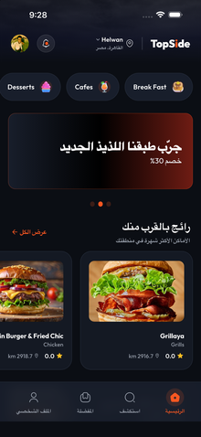
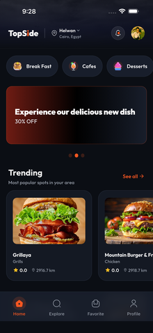
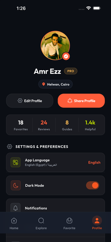

# TopSide 🇪🇬

### Discover Egypt. Find Your Next Favorite Place.

**TopSide** is a Flutter mobile app for discovering the best food spots in **Helwan, Cairo** — Egyptian restaurants, charcoal grills, cafés, desserts and street food. It combines curated discovery, search and filters, nearby places, favorites, reviews and a personalized profile in one polished, bilingual (English / العربية) experience.

From restaurants and cuisines to featured destinations and local businesses, TopSide brings local discovery into one convenient application.

> **Project Status:** Under Active Development

Built with Flutter, Riverpod, GoRouter and a Supabase backend, with a companion React admin dashboard for content management.

---

## 📱 Screenshots

### Home

| Arabic | English |
|:---:|:---:|
|  |  |

### Business Details

<p align="center">
  
</p>

### Explore & Search

<p align="center">
  
</p>

### Favorites

<p align="center">
  
</p>

### Profile

<p align="center">
  
</p>

---

## ✨ Features

### Onboarding
- A three-step intro explaining the app's core idea: discover Helwan's best food, explore by vibe & cuisine, and save & share favorites.
- Animated illustrations (Lottie), animated page dots, **Skip** and **Next / Get Started** controls.
- Completion flag persisted with Hive; the router uses it to gate the rest of the app.

### Home & Discovery
- CMS-driven home sections: hero highlight card, auto-advancing promo banner carousel, category pills (Breakfast, Cafés, Desserts…), nearby cuisines, trending, featured, best sellers, recommended and "See all" lanes.
- Market/location awareness (Helwan, Cairo, Egypt) with nearby place lists, distance labels and open/closed status.
- Card treatments (featured, compact, default, small, full, search result, skeleton, trending) built on a single `AppCard` design-system base.

### Explore & Search
- Free-text search across businesses with recent searches, cuisine pills and category chips.
- Filter sheet for price range, maximum distance, dietary requirements (vegan, vegetarian, halal, …), amenities (open now, outdoor seating, delivery, reservations) and sorting by rating or distance.
- Vibe collections ("Late Night Nile", "Baladi Heritage", "Co-working & Cafés") and trending spots.

### Business Details
- Rich detail screen with hero photo, photo gallery, rank/tier badges, rating, distance and open-hours.
- Branch selector with per-branch hours, phones, WhatsApp, maps link and "open now" logic.
- Signature menu highlights, promo offers (e.g. 20% off), share, directions, call and WhatsApp actions.
- Hero photo flight transition from the originating card into the detail screen.

### Favorites
- Bookmark/unbookmark places from cards and the detail screen, with undo on removal.
- Smart buckets and cuisine lanes, "Must-Visit Again" section, search, filter and sort (top rated / recently added).
- Animated empty and no-results states.

### Reviews
- Write reviews with a star rating, optional title and content.
- Review lists on business details, review history, helpful votes, owner responses and report dialog.

### Auth & Profile
- Email/password sign up and login, Google and Apple social sign-in, forgot-password flow, email verification and change password.
- Session persistence and router guards for onboarding → auth → protected routes.
- Profile screen with avatar, stats (favorites, reviews, guides, helpful), level/badges, reviews & guides tabs, preferences (language, dark mode, notifications, privacy) and share profile.

### Platform & UX
- **Bilingual & RTL:** English and Arabic via `easy_localization` with JSON catalogs, real locale → `Directionality` wiring, mirrored directional icons.
- **Theming:** Material 3 light/dark themes, centralized tokens (`AppColors`, `AppSpacing`, `AppRadii`, `AppShadows`, typography, durations, curves).
- **Responsive:** phone tiers (compact / regular / large), `flutter_screenutil`, text-scaling-safe layouts verified at 320/375/430dp and 130% text scale.
- **Feedback:** skeleton loading states, empty/error states, Lottie illustrations and smooth page transitions.

### Companion Dashboard
A React + Vite + TypeScript admin dashboard lives in the private application repository under `dashboard/` for managing app content through Supabase.

*Features and screens are being continuously improved as development progresses.*

---

## 🛠️ Tech Stack

| Area | Choice |
| --- | --- |
| Framework | Flutter (Dart 3.8+) |
| State management | Riverpod 3 with code generation |
| Navigation | `go_router` with onboarding/auth redirects |
| Backend | Supabase (Postgres, Auth, Storage) |
| Local state | `flutter_hooks` |
| Local persistence | Hive (onboarding flag, bookmarks cache) |
| Localization | `easy_localization` (EN/AR JSON) |
| UI | Material 3, custom design system, `flutter_screenutil`, Lottie, skeletonizer |
| Data models | Freezed + JSON serialization |
| Location | `geolocator` / `geocoding` |
| Icons | `hugeicons`, `iconsax_plus` |
| CI | GitHub Actions |
| Testing | `flutter_test`, `mocktail`, integration tests |

---

## 🏗️ Architecture

TopSide follows a feature-oriented, layered architecture designed for maintainability and a clear separation of concerns.

```text
lib/
├── main.dart                 # bootstrap: localization, dotenv, Hive, splash
└── src/
    ├── app.dart              # MaterialApp.router, themes, wrappers
    ├── routing/              # routes, guards, page transitions
    ├── theme/                # design tokens & light/dark themes
    ├── core/                 # config, i18n, errors, utils
    ├── shared/               # design-system widgets, hooks, providers, wrappers
    └── features/
        ├── auth/
        ├── businesses/
        ├── category/
        ├── favorites/
        ├── home/
        ├── media/
        ├── onboarding/
        └── reviews/
```

Each feature follows a clean, layered structure: `data/` (datasources, DTOs, repositories), `domain/` (entities, repository contracts, use cases) and `presentation/` (screens, widgets, providers).

**Architectural principles**

- **Separation of concerns:** each layer has one clearly defined responsibility.
- **Repository pattern:** business logic is decoupled from data sources.
- **Data source abstraction:** remote data access is handled independently.
- **Feature-based organization:** related functionality is grouped together.
- **Dependency management:** Riverpod manages application dependencies and state.

---

## ⚙️ Continuous Integration

The project uses **GitHub Actions** to automate quality checks on every change:

- Flutter environment setup
- Dependency installation
- Dart formatting verification
- Static code analysis
- Automated test execution

This helps identify issues early and maintain a consistent development workflow.

---

## 🗺️ Roadmap

- [x] Initial Flutter application setup
- [x] Supabase integration
- [x] Authentication foundation
- [x] Home discovery data integration
- [x] Business discovery foundation
- [x] Favorites integration
- [x] Onboarding flow
- [x] GitHub Actions CI workflow
- [ ] Complete application UI and UX
- [ ] Improve search and discovery experience
- [ ] Complete testing coverage
- [ ] Android production release
- [ ] Google Play deployment
- [ ] Expand local discovery coverage across Egypt

---

## 👨‍💻 About the Developer

**Amr Essam Ezz**

Flutter Developer focused on building maintainable, scalable, and user-centered mobile applications.

**Core Skills:** Flutter & Dart, Riverpod state management, Supabase & PostgreSQL, REST API integration, clean architecture, Git & GitHub Actions.

GitHub: [@AmrEzz0111](https://github.com/AmrEzz0111)

---

## 📄 License

No license has been specified for this repository yet.

---

> **Showcase repository:** This public repository contains project documentation and screenshots only. The application source code, dashboard implementation, and backend configuration remain in the private TopSide repository.
