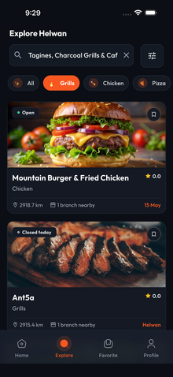
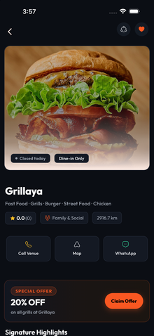
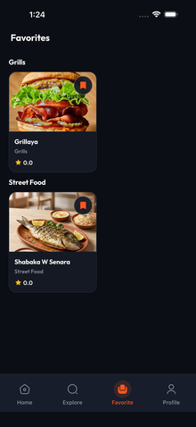

# TopSide 🇪🇬

### Discover Egypt. Find Your Next Favorite Place.

  A local discovery platform designed to help people explore places, discover businesses, and find new experiences across Egypt.

  <strong>Flutter · Dart · Riverpod · Supabase · PostgreSQL</strong>

---

## About the Project

TopSide is a mobile application focused on making local discovery easier and more engaging.

The platform brings places, businesses, curated content, and personalized favorites into one experience, helping people discover interesting destinations and explore what their city has to offer.

**Project Status:** Under Active Development

## App Preview

### Home

| Arabic | English |
|:---:|:---:|
|  |  |

### Explore

  

### Business Details

  

### Favorites

  

### Profile

  

## Core Experience

- **Discover:** Explore places and businesses through curated content.
- **Explore:** Browse categories and available destinations.
- **Business Profiles:** View business information and details.
- **Favorites:** Save interesting places for later.
- **Personalized Experience:** Access account-related features and content.

## Technology Stack

| Technology | Usage |
|---|---|
| Flutter & Dart | Cross-platform mobile development |
| Riverpod | State management |
| GoRouter | Application navigation |
| Supabase | Backend services and authentication |
| PostgreSQL | Relational database |
| REST APIs | Data communication |
| GitHub Actions | Continuous Integration |

## Engineering Highlights

- Feature-oriented project organization.
- Layered architecture and separation of concerns.
- Repository pattern for data access abstraction.
- Centralized state and dependency management.
- Automated code quality checks using GitHub Actions.

## Project Scope

This repository is a **visual portfolio showcase** of TopSide.

It contains selected application screenshots and project documentation only. The original application source code and backend implementation are maintained separately in a private repository.

The screenshots and descriptions represent the project as it evolves during development.

## Developer

**Amr Essam Ezz**  
Flutter Developer

- GitHub: [@AmrEzz0111](https://github.com/AmrEzz0111)

---

  <strong>TopSide — Discover More. Explore Better.</strong>

